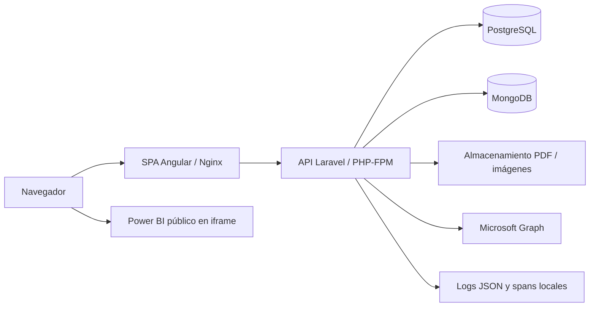

# Manual técnico de operación

Versión local de 8 de noviembre de 2026. Este documento describe el código y el ensayo portable; la infraestructura, dominio, almacenamiento y política de backups de DIIT aún necesitan confirmación. No sustituye una aceptación institucional ni implica que esta revisión esté desplegada.

## Arquitectura y fuentes de datos



El frontend se publica como SPA con API del mismo origen en el ensayo portable; no necesita un servidor Node en runtime. La API aplica autenticación por sesión/cookies y CSRF, autorización por rol y observatorio, validación, publicación y lectura de archivos. La separación de dominio/aplicación/infraestructura es gradual: las excepciones de arquitectura conocidas están documentadas en [calidad CI](CALIDAD_CI_FASE5.md).

PostgreSQL conserva usuarios, roles/asignaciones, observatorios, categorías y publicaciones nativas, decisiones y mapas/recibos de compatibilidad. MongoDB conserva los datos/documentos de los módulos heredados. Los PDF e imágenes son archivos, no deben suponerse incluidos en un dump SQL. Las importaciones PDF de SharePoint guardan una copia gestionada; un enlace público Power BI sigue dependiendo de Microsoft. Atlas publica enlaces mediante su biblioteca de categorías.

Consultar [cierre editorial](CIERRE_TECNICO_FASE3.md), [privacidad/conservación](PRIVACIDAD_CONSERVACION_PUBLICACIONES_FASE2.md) y [archivos SharePoint](ARCHIVOS_SHAREPOINT_FASE3.md) antes de modificar compatibilidad, permisos o almacenamiento. El rediseño completo de Barómetro está aplazado; no eliminar sus datos ni contratos por esa decisión visual.

## Requisitos y configuración

| Componente | Línea verificada |
|---|---|
| Build frontend | Node 24.17.0, npm 11.13.0, Angular 21; versiones exactas en lockfile. |
| API | PHP 8.4 con MongoDB PECL 2.5.2, PDO PostgreSQL, GD, ZIP, intl, bcmath y demás requisitos de Composer. |
| Datos del ensayo | PostgreSQL 16, MongoDB 7, volúmenes separados. |
| Contenedores | Docker Engine local y Compose v2; imágenes portable con bases fijadas por digest. |
| PDF | PDF.js y worker `.mjs` servidos con MIME JavaScript, `nosniff` y CSP. |

Usar `npm ci` y `composer install` con sus locks; no usar `update`, `--force`, ignorar requisitos de plataforma ni copiar dependencias del host para instalar una entrega. El Dockerfile portable instala producción sin scripts/plugins y comprueba los requisitos reales. El Dockerfile publicado heredado no es idéntico al portable: su sustitución se valida por separado, no cambiando el servicio a ciegas.

Variables por nombre y propósito; valores privados en el gestor de secretos del entorno:

| Grupo | Variables relevantes |
|---|---|
| Aplicación | `APP_KEY` para cifrado/sesión; `APP_URL`, `FRONTEND_URL`; `APP_ENV=production`, `APP_DEBUG=false`. Conservar APP_KEY para restaurar; no regenerarla en cada despliegue. |
| PostgreSQL | `DB_CONNECTION`, `DB_HOST`, `DB_PORT`, `DB_DATABASE`, `DB_USERNAME`, `DB_PASSWORD`, `DB_SSLMODE`; elegir y documentar uso de `DB_URL`/`DATABASE_URL`, evitando un override accidental. |
| MongoDB | `MONGODB_URI`, `MONGODB_DATABASE`; mínimo privilegio y autenticación sobre la base correspondiente. |
| Sesión y red | `SESSION_DRIVER`, `SESSION_COOKIE`, `SESSION_SECURE_COOKIE`, `SESSION_SAME_SITE`, `SANCTUM_STATEFUL_DOMAINS`; orígenes CORS/proxy configurados conforme al dominio final. |
| Archivos | `FILESYSTEM_DISK` y parámetros del disco elegido en `config/filesystems.php`; incluir tanto privados como imágenes en el plan de persistencia/respaldo. |
| Microsoft | `MICROSOFT_TENANT_ID`, `MICROSOFT_CLIENT_ID`, `MICROSOFT_CLIENT_SECRET`, `SHAREPOINT_DRIVE_ID`, `SHAREPOINT_FOLDER_PATH`, `SHAREPOINT_BAROMETER_FOLDER_PATH`. No copiar enlaces/credenciales a logs. |
| Correo/OAuth | Variables de `config/mail.php` y `config/services.php` según proveedor real. El ensayo usa correo array y no prueba entregabilidad ni OAuth real. |
| Operación | `LOG_*`, `OBSERVABILITY_*`; [esquema, retención y configuración](OBSERVABILIDAD_FASE5.md). |

`backend/.env.example` es una plantilla sin secretos. Los valores `PORTABLE_*` del ensayo son distintos y los genera su inicializador. No utilizar secretos de producción en E2E ni compartir la salida expandida de `docker compose config`.

## Instalación y arranque local portable

Seguir [ensayo portable](ENSAYO_PORTABLE_FASE4.md). Desde una copia del commit revisado:

```powershell
node scripts/init-portable-env.mjs
docker --context default compose --project-name observatorio-portable-ensayo --env-file storage/codex-local/portable/.env -f deploy/portable/compose.yml config --quiet
docker --context default compose --project-name observatorio-portable-ensayo --env-file storage/codex-local/portable/.env -f deploy/portable/compose.yml build --builder default
```

En volúmenes **nuevos**, el verificador de fase 4 prepara esquema y datos sintéticos, comprueba persistencia y restauración:

```powershell
node scripts/test-portable-runtime.cjs
```

No ejecutar ese verificador como instalador sobre una base con datos reales. Para un ensayo ya preparado, levantar las bases, invocar explícitamente la tarea `schema` del perfil tools según la guía y después API/web. El arranque normal solo prepara cachés, no hace seed ni cambia el esquema automáticamente. El puerto es `127.0.0.1:4400`; solo web publica puerto. Los motores y PHP se comunican por la red interna.

Comprobación inicial:

```powershell
node scripts/check-operational-health.mjs --url http://localhost:4400
```

Verificar además sesión/CSRF, un archivo autorizado y su denegación anónima, publicaciones por observatorio, lectura PDF/Power BI y metadatos. [E2E](E2E_FASE5.md) ejecuta esos recorridos con datos nuevos en `localhost:4500` y retira solo sus recursos al terminar:

```powershell
cd frontend
npm ci --no-audit --no-fund
npx --no-install playwright install chromium --only-shell
npm run test:e2e
```

## Operación ordinaria

- Registrar commit, fecha, entorno y resultado de la entrega. Configurar `OBSERVABILITY_RELEASE` con el hash del commit.
- Comprobar salud superficial y profunda. HTTP 200 por sí solo no prueba conectividad; revisar `ok/services` o utilizar el verificador.
- Mantener `APP_DEBUG=false`. Usar el ID de la respuesta para correlación; no recopilar cookies, tokens, URLs privadas o documentos del usuario como diagnóstico rutinario.
- Vigilar espacio de datos/archivos, tamaño de logs, estado de contenedores, errores y latencia. El ensayo limita logs Docker por tamaño; el host publicado debe tener su propia retención y acceso restringido.
- No ejecutar limpieza de volúmenes, `migrate:fresh`, seed, downgrade del esquema o comandos de ensayo sobre los servicios reales.

Para detener el ensayo **conservando datos**:

```powershell
docker --context default compose --project-name observatorio-portable-ensayo --env-file storage/codex-local/portable/.env -f deploy/portable/compose.yml down
```

No añadir `--volumes`. El proyecto E2E tiene otro nombre y su limpieza desechable no debe reutilizarse para operar una instalación persistente.

## Respaldo y restauración

La unidad de recuperación es **PostgreSQL + MongoDB + archivos + configuración/APP_KEY + commit**. Los IDs y mapas de compatibilidad deben corresponder al mismo punto de recuperación.

1. Definir una ventana consistente de escritura detenida para datos y archivos; suspender importaciones y escritores externos además de la API. Registrar el último commit, esquema y hora UTC. Un dump aislado no garantiza consistencia entre los dos motores y archivos.
2. Crear dump PostgreSQL en formato custom, archivo MongoDB y archivo del almacenamiento gestionado. Preservar propietarios/permisos necesarios, recibos y referencias; la configuración privada/APP_KEY se guarda por separado con acceso restringido. No depender de que el filesystem efímero del servicio conserve los PDFs.
3. Guardar fuera de los contenedores, cifrar con el mecanismo institucional, limitar acceso y registrar tamaños/huellas SHA-256 y fecha. No versionar ni subir a CI. Evitar redirecciones de dumps binarios mediante shells que puedan recodificarlos; usar copia binaria como en los verificadores del ensayo.
4. Restaurar primero en **otras bases y otro volumen**, sin apuntar servicios públicos a la copia ni sobrescribir el origen. Adaptar solo la configuración de la aplicación restaurada y conservar APP_KEY.
5. Levantar esa aplicación, verificar salud, iniciar sesión, comprobar asignaciones/restricciones, filas y bytes de PDFs, paginación, categorías y lectura. Comparar huellas y resultados con el manifiesto.
6. Registrar duración, pérdida de datos observada y evidencia. Acordar RPO/RTO y retención con DIIT a partir del ensayo; no asumir valores prometidos sin medición. Solo entonces preparar un cambio controlado de origen.

El procedimiento ejecutado y sus comprobaciones están en [recuperación del ensayo portable](ENSAYO_PORTABLE_FASE4.md). Sus scripts contienen las invocaciones concretas probadas de dump/copia/restauración y guardan evidencia privada en `storage/codex-local/portable`. No son una tarea programada de backup de producción. Falta elegir el destino institucional, cifrado/llaves, calendario, responsables y hacer un ensayo sobre la topología definitiva.

## Entrega, migraciones y reversión

1. Trabajar en rama separada. Revisar diff y locks; ejecutar los controles de CI, incluidos secretos, Composer/npm audit, PHPStan/lint, PHP SQLite/PostgreSQL, build, cabeceras y E2E. Resolver avisos o excepciones documentadas; no eludir `Resultado` ni publicar sin PR verificado.
2. Identificar cambios de esquema y compatibilidad hacia atrás. Revisar migraciones que protegen identidades/restricciones de archivos. Preparar respaldo y probar recuperación en copia antes de una migración de datos.
3. Construir la imagen del commit revisado, preservar persistencia/configuración y probarla en ensayo. Invocar cambios de esquema como tarea explícita; sin seed. Los locks de migración actuales se comprobaron para un host, no para varios hosts independientes.
4. En la ventana acordada, publicar el artefacto revisado, validar salud/cookies/CSRF/roles/archivos y revisar logs por versión. Mantener la versión anterior y el respaldo verificado hasta completar la aceptación.
5. Para revertir solo código, comprobar primero que la versión anterior entiende el esquema y las marcas de privacidad/identidad presentes. Si no es compatible, no hacer `migrate:rollback` automático: conciliar lotes y usar la restauración completa verificada, con la interrupción correspondiente. No borrar mapas o restricciones para hacer funcionar código antiguo.

La rama publicada y el servicio concreto se verifican antes de cualquier despliegue. Los nombres de ramas no garantizan a qué base/almacenamiento apunta el runtime. Esta entrega permanece local: no cambia la rama de producción ni la configuración de Vercel/Render.

## Diagnóstico

| Síntoma | Comprobación |
|---|---|
| Login 419 | Cookie CSRF, origen/puerto, proxy de Sanctum/API y cookies; no desactivar CSRF. |
| Login 401 | Cuenta/credencial/verificación/estado en la base del entorno correcto. No confundir cuentas locales y publicadas. |
| 403/404 al consultar archivo | Rol, alcance, estado y contexto de gestión. Puede ocultarse el recurso para no revelar su existencia. |
| PDF 409 | Falta la copia gestionada; revisar/reimportar con el flujo autorizado. |
| PDF no renderiza | HTTP/MIME del worker `.mjs`, CSP, copia PDF, autenticación y consola de errores; no habilitar `unsafe-eval` ni desactivar `nosniff`. |
| Importación falla | Carpeta/drive y permiso de aplicación Microsoft, vigencia del secreto, archivo PDF válido y almacenamiento. Logs solo muestran clase/código e ID de petición. |
| Power BI no aparece | URL pública admitida, disponibilidad y autorización del reporte en Microsoft; un link público no es una barrera de privacidad. |
| Salud profunda falsa con 200 | Revisar el motor indicado y su conectividad privada; el frontend conserva el contrato de warmup. |
| Sin logs/spans | Nivel del canal, muestreo, sink, permisos/retención y release; ver la guía de observabilidad. |

Los mensajes nativos de arranque y herramientas CLI pueden quedar fuera de la redacción de Laravel. No compartirlos íntegros ni exponer logs al portal. Conservar evidencia del incidente y resolver/rotar cualquier secreto expuesto conforme al procedimiento institucional; limpiar un log no revoca un secreto.

## Pendientes de aceptación

Confirmación de host/proxy/TLS/dominio y recursos; almacenamiento persistente y backups programados; IAM/red/retención de logs; monitoreo/alertas y posible Collector; RPO/RTO medidos; pruebas de correo, OAuth y Microsoft reales; CI remoto e integración de las ramas locales. El análisis estático de otras capas y dos dependencias de presentación conocidas siguen pendientes. El análisis ECharts y su excepción se retiraron el 10 de noviembre; consultar [alcance y comprobaciones](RETIRO_ANALISIS_GRAFICO_20261110.md).
